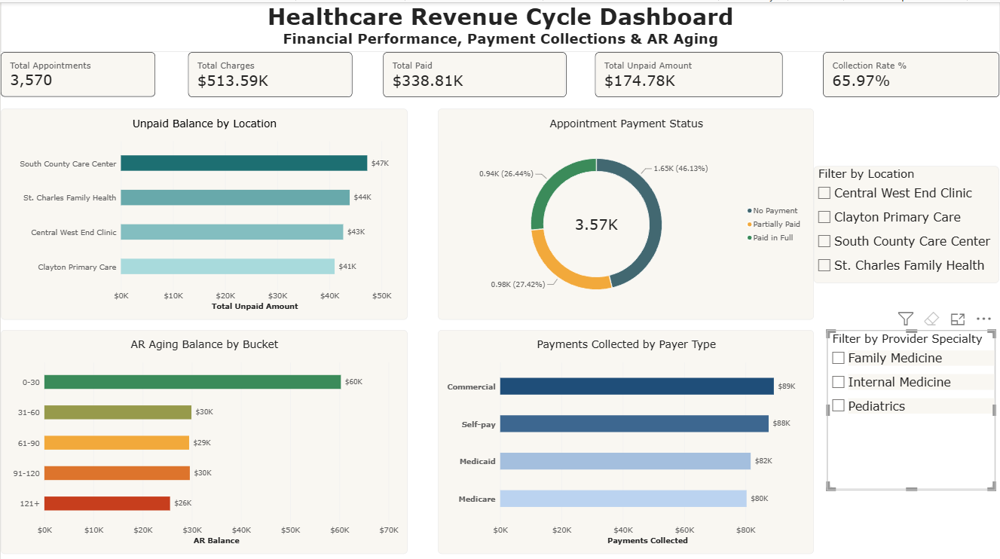
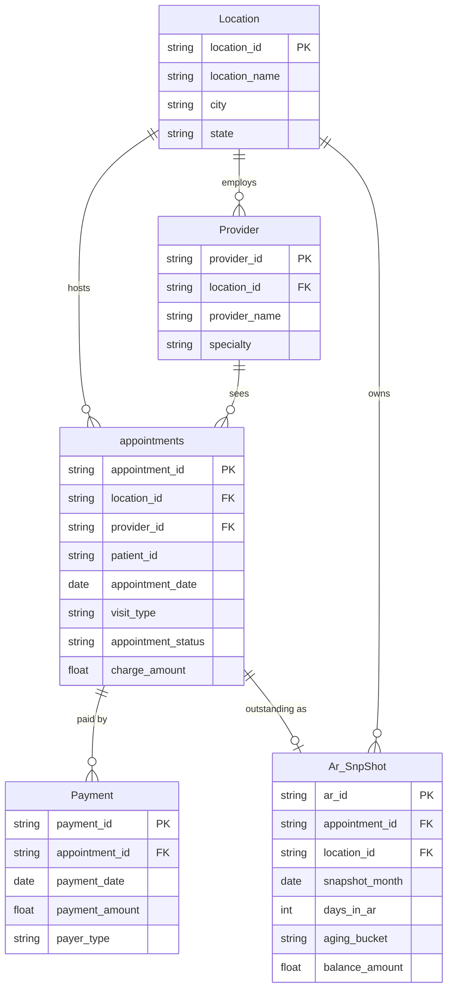
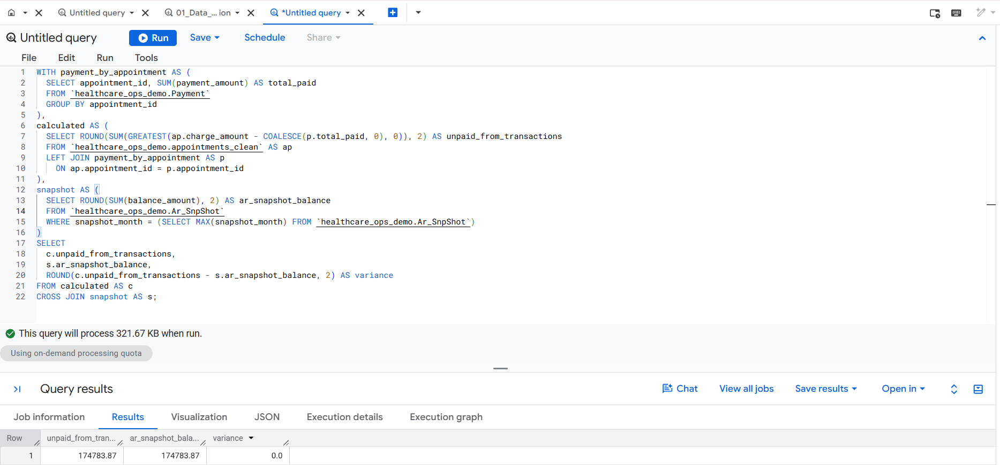

# Healthcare Revenue Cycle Data Warehouse

**Google BigQuery · SQL · Power BI**

A star-schema data warehouse built in Google BigQuery on simulated multi-location clinic data (appointments, payments, and A/R). The project covers SQL data profiling, cleaning, and reconciliation, then publishes reporting views to a Power BI revenue cycle dashboard.

> All data is simulated. No real patient information (PHI) is used.



---

## Business questions

- How much was charged, how much was collected, and what is still unpaid?
- Which locations and providers carry the largest unpaid balances?
- How old is outstanding A/R, and which location should be prioritized for follow-up?
- Do payment and A/R records reconcile with appointment charges?

---

## Data model

Two dimension tables and three fact tables, loaded from CSV into the `healthcare_ops_demo` dataset.



| Table | Type | Rows | Description |
|---|---|---|---|
| `Location` | Dimension | 4 | Clinic locations in the St. Louis area |
| `Provider` | Dimension | 8 | Providers and specialty (Family Medicine, Internal Medicine, Pediatrics) |
| `appointments` | Fact | 3,571 | Appointments, Jan–Jun 2026, with charge amount |
| `Payment` | Fact | 1,924 | Payments by payer type (Commercial, Medicare, Medicaid, Self-pay) |
| `Ar_SnpShot` | Fact | 1,432 | Month-end A/R snapshot (June 30, 2026) with aging buckets |

---

## Pipeline

| Step | Script | What it does |
|---|---|---|
| 1 | [`01_data_profiling.sql`](sql/01_data_profiling.sql) | Schema review; row counts, distinct keys, and null keys for every table |
| 2 | [`02_data_cleaning.sql`](sql/02_data_cleaning.sql) | Confirms the duplicate is a true duplicate; builds `appointments_clean` |
| 3 | [`03_reconciliation.sql`](sql/03_reconciliation.sql) | Orphan-record checks; financial summary; A/R snapshot tie-out |
| 4 | [`04_analysis.sql`](sql/04_analysis.sql) | Performance by provider and location, A/R aging, aged A/R by location, monthly volume |
| 5 | [`05_reporting_views.sql`](sql/05_reporting_views.sql) | `appointment_financials` and `ar_aging_latest` views consumed by Power BI |

---

## Data quality and reconciliation findings

| Check | Result |
|---|---|
| Duplicate appointments | **1 true duplicate** (3,571 rows vs. 3,570 unique IDs), removed in `appointments_clean` |
| Payments with no matching appointment | **1 orphan payment** (PAY99999 → APT99999, $125.00) |
| Appointments with no payment | 1,647: 1,194 No Show/Cancelled visits with a $0 charge, plus **453 completed visits still unpaid** |
| Missing values | 1 appointment with a blank `visit_type` |
| Orphan provider/location keys | 0 |
| **A/R snapshot vs. calculated unpaid balance** | **$174,783.87 vs. $174,783.87: variance $0.00** |



Example: the A/R tie-out query from `03_reconciliation.sql`

```sql
SELECT
  c.unpaid_from_transactions,
  s.ar_snapshot_balance,
  ROUND(c.unpaid_from_transactions - s.ar_snapshot_balance, 2) AS variance
FROM calculated AS c
CROSS JOIN snapshot AS s;
```

---

## Key results

| Metric | Value |
|---|---|
| Appointments (clean) | 3,570 |
| Total charged | $513,590.30 |
| Total collected | $338,806.43 |
| Unpaid balance | $174,783.87 |
| Collection rate | 65.97% |

**A/R aging (June 30, 2026 snapshot)**

| Bucket | Balance |
|---|---|
| 0–30 days | $60,298 |
| 31–60 days | $29,906 |
| 61–90 days | $29,441 |
| 91–120 days | $29,584 |
| 121+ days | $25,556 |

- About **31% of outstanding A/R ($55.1K) is over 90 days old**.
- **Clayton Primary Care** carries the most A/R over 90 days (~$15.0K), so it is the first priority for follow-up.

---

## Power BI dashboard

The report connects to the two BigQuery reporting views and includes:

- KPI cards: total appointments, charges, payments, unpaid balance, collection rate
- Unpaid balance by location
- Appointment payment status (No Payment / Partially Paid / Paid in Full)
- A/R aging balance by bucket, color-coded from current (green) to aged (red)
- Payments collected by payer type
- Slicers for location and provider specialty that filter every visual

The `.pbix` file is in [`powerbi/`](powerbi/).

---

## Repository structure

```
healthcare-revenue-cycle-warehouse/
├── README.md
├── data/        # simulated source CSVs loaded into BigQuery
├── sql/         # profiling, cleaning, reconciliation, analysis, views
├── powerbi/     # Power BI report (.pbix)
└── images/      # dashboard and BigQuery screenshots
```

## Tools

Google BigQuery (GoogleSQL) · Power BI Desktop (Power Query, DAX) · CSV source data

**Live SQL in BigQuery:** [Full pipeline script](https://console.cloud.google.com/bigquery?sq=7681303979:2655a77406694f37bee480400543ecd8) *(requires a Google account to view)*

---

**Mohd Adnaan Khan**, Healthcare Data Analyst · [LinkedIn](https://www.linkedin.com/in/mohd-adnaan-khan-147b681a9/) · [GitHub](https://github.com/Adnaan-khan)
